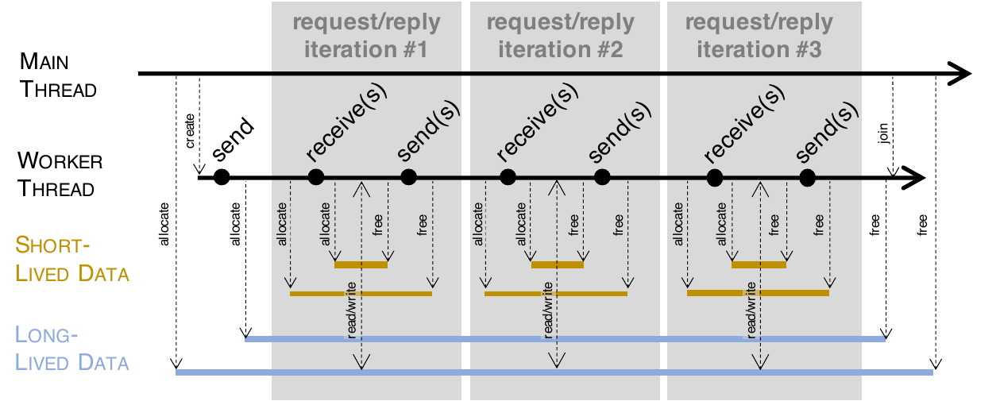
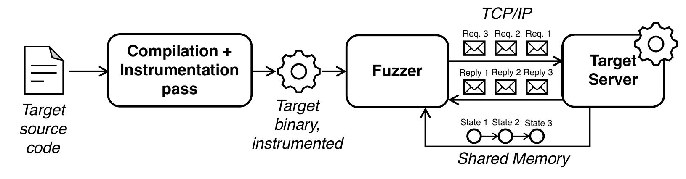
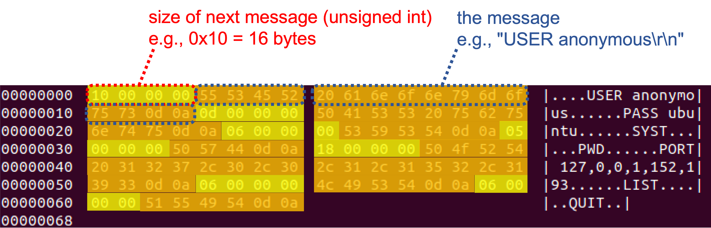

# StateAFL: A Coverage-Driven (Greybox) Fuzzer for Stateful Network Protocols
StateAFL is a fuzzer designed for network servers. It extends the original idea of the AFL fuzzer, which automatically evolves fuzz inputs to maximize code coverage. In addition to code coverage, StateAFL seeks to maximize protocol state coverage.

The aim of this tool is to contribute towards a completely-automated solution for stateful protocol fuzzing (similarly to what AFL was able to achieve for stateless programs) and to promote a wider application of fuzzing in real-world systems. The fuzzer does not require developers to implement custom message parsers for the protocol under test.

StateAFL automatically infers the current protocol state of the server. At compile-time, it instruments the target server with probes on memory allocations and network I/O operations. At run-time, it takes snapshots of long-lived data within process memory for each protocol iteration (see figure), and it applies fuzzy hashing to map the in-memory state to a unique protocol state.





StateAFL has been implemented on top of the codebase of [AFL](http://lcamtuf.coredump.cx/afl/) and [AFLnet](https://github.com/aflnet/aflnet). To fuzz a server, it should be compiled using `afl-clang-fast` (using the modified version that is included in this project, not the one from AFL), to perform a compiler pass for instrumenting the target.


# Reference

More information about StateAFL is available in the following [research paper](https://link.springer.com/article/10.1007/s10664-022-10233-3) with open access. The paper is also available on [arXiv](https://arxiv.org/pdf/2110.06253v2.pdf). If you use this code in your scientific work, please cite the paper as follows:

```
@article{StateAFL,
  author={Roberto Natella},
  title={StateAFL: Greybox Fuzzing for Stateful Network Servers},
  journal={Empirical Software Engineering},
  volume={27},
  number={191},
  publisher={Springer},
  url={https://doi.org/10.1007/s10664-022-10233-3},
  year={2022},
}
```


# ProFuzzBench

If you want to run some experiments quickly, please take a look at [ProFuzzBench](https://github.com/profuzzbench/profuzzbench). ProFuzzBench includes a suite of representative open-source network servers for popular protocols (e.g., TLS, SSH, SMTP, FTP, SIP), and tools to automate experimentation. StateAFL has been integrated into that benchmark.


# Installation: Ubuntu 24.04 LTS / LLVM 18 (x86_64)

The LLVM 18 port retains StateAFL's memory snapshots, TLSH/MVPTree inference,
network and custom I/O tracing, state calibration, shared-memory feedback and
AFLNet scheduling. The default instrumentation is StateAFL's own New PM plugin.
See [the source audit](LLVM18_MIGRATION_AUDIT.md) and
[the measured test report](LLVM18_TEST_REPORT.md) for scope and evidence.

The separate [ChatAFL source audit](docs/CHATAFL_SOURCE_AUDIT.md) and
[evaluation review](docs/CHATAFL_EVALUATION_REVIEW.md) document the three LLM
mechanisms and their compatibility constraints. This is a research review;
the LLM mechanisms have not been integrated or evaluated in this checkout.

Use the existing system LLVM 18.1.3 toolchain. No separate LLVM download,
versioned executable name, or manual installation into `/usr/lib/llvm-18` is
required. Check that the normal commands on PATH match:

```bash
command -v clang clang++ llvm-config opt llvm-dis cmake
clang --version
clang++ --version
llvm-config --version
opt --version

# Run inside this checkout. The three source dependency revisions are pinned.
git submodule update --init --recursive
make clean
make -j2
make -C llvm_mode -j2
```

The defaults are `CC=clang`, `CXX=clang++`, `LLVM_CONFIG=llvm-config`,
`CLANG=clang`, and `CLANGXX=clang++`, resolved through PATH. The LLVM build checks
that the selected Clang commands and LLVM configuration have matching major
versions. It obtains the required header and linker flags from the system
`llvm-config`; a package-managed path such as `/usr/lib/llvm-18` in those flags
is the system package layout, not a separately downloaded toolchain.

`CC`/`CXX` still allow explicit build compiler overrides; `CLANG`/`CLANGXX`
override the wrapper's default target compiler commands. At target compilation
time, the original `AFL_CC`/`AFL_CXX` overrides take priority. `AFL_PATH` still
locates the plugin and runtime objects. Explicit `-O0` through `-O3` and `-g0`
are honored; without explicit flags, the wrapper retains its original `-O3 -g`
defaults. `AFL_DONT_OPTIMIZE`, ASAN/MSAN, hardening and the other original options remain.

Other build dependencies are a C/C++ development environment, CMake, Graphviz
development headers, binutils, git, and Python 3. This machine already provides
them. Do not delete a system package directory targeted by `/usr/bin/clang` or
`/usr/bin/llvm-config`: that would remove the working system toolchain.

The dependency libraries are rebuilt from source in `llvm_mode/.build`; the old
tracked archives are not used. A small patch to the pinned TLSH C wrapper adds
its missing return value, avoiding a Clang 18 `SIGILL` during distance matching.
The source submodules remain unmodified. Runtime data-section renaming and the
separate C/C++ tracer objects are retained. `make install` installs both tracer
objects as well as the original coverage runtimes.

```bash
export STATEAFL="$PWD"
export PATH="$STATEAFL:$PATH"
export AFL_PATH="$STATEAFL"

# Confirm the actual compiler selected by the wrapper and its plugin argument.
afl-clang-fast --version
afl-clang-fast -### -O0 -c test-instr.c

# Compile a real local server (C++ projects use afl-clang-fast++).
afl-clang-fast -O2 -g tests/llvm18/network_server.c -o /tmp/stateafl-server

# Obtain LLVM IR and verify it independently with the matching LLVM version.
afl-clang-fast -O1 -g0 -S -emit-llvm tests/llvm18/state_fixture.c -o /tmp/stateafl.ll
opt -passes=verify -disable-output /tmp/stateafl.ll
```

For configure/CMake projects use `CC=$STATEAFL/afl-clang-fast` and
`CXX=$STATEAFL/afl-clang-fast++`; compiling to objects and linking in a separate
step are both supported. Rebuild target objects when changing instrumentation.

## Reproduce the regression tests

```bash
# IR matrix, wrapper/coverage/sanitizer checks, object and I/O records,
# real state/calibration SHM, and a bounded local server campaign.
bash tests/llvm18/run_all.sh tests/llvm18/out/reproduction

# The end-to-end test alone generates length-prefixed seeds and checks
# coverage, new queue entries, inferred state paths, calibration and ipsm.dot.
python3 tests/llvm18/e2e.py --output tests/llvm18/out/campaign --seconds 45

```

Use a new output directory for each campaign. StateAFL requires stable process
addresses for memory-state analysis. The test uses Linux `setarch -R` when the
system ASLR setting is enabled; the fuzzer checks the inherited
`ADDR_NO_RANDOMIZE` personality. To launch a campaign manually, use
`setarch "$(uname -m)" -R afl-fuzz ...` or the original system-wide ASLR setup.
Both forkservers inherit this setting. Environments that prohibit the Linux
personality call need the original administrator-managed ASLR setting.

A working coverage map alone does not prove state inference. Inspect
`state-feedback/data/state-feedback.json` for initial state 0, distinct and
repeatable nonzero state sequences, 72-character TLSH hashes and calibration
distances. For the campaign, inspect `result.json`, `out/ipsm.dot`,
`out/replayable-new-ipsm-paths`, `out/tlsh.log`, and `out/fuzzer_stats` together.
The scripts fail on missing state evidence or recorded crashes/hangs. The local
test protocol uses two-byte frames, and its preflight checks that TCP coalescing
and fragmentation produce the same replies and shared-memory state sequence.

## Custom I/O and compatibility limits

The existing semicolon-separated syntax remains:
`TRACE_CUSTOM_RECEIVE='receive_record:1;receive_event'` and
`TRACE_CUSTOM_SEND='send_record:1'`. Argument indices start at zero. A struct
pointer is recovered from IR allocations, globals, typed GEPs, formal parameter
uses, or debug signatures. An event without an index retains the original
NULL/zero buffer event. If opaque external IR contains no recoverable type,
compilation emits an explicit diagnostic; optionally provide its fixed byte
size, for example `receive_record:1:256`. Invalid indices, ambiguous types and
unrepresentable sizes are diagnosed rather than silently suppressing tracing.
`recvmsg/sendmsg` retain the original msghdr-object exclusion semantics; they do
not substitute the iovec payload for that object.

At `-O0`, Clang normally does not emit lifetime intrinsics, so ordinary C stack
lifetime hooks are absent as in the original compiler behavior. Optimized C/C++
and explicit lifetime IR retain the original 64-byte minimum. The original
optional `AFL_TRACE_PC` build target remains available; it is an opt-in legacy
coverage mode, not a replacement for the default StateAFL plugin.

The supported and fully exercised target is x86_64. Original optional 32-bit
coverage-object generation is retained, but a complete 32-bit tracer and its
multilib dependencies were not present in the baseline and are not supplied by
this migration. 32-bit IR is validated separately. Runtime size arguments now
match `size_t`; the original postexecution hashing still has `int` offsets and
length limits, so multi-GiB snapshot hashing is not certified. Other preexisting
limits and untested optional configurations are recorded in the audit/report.

## Setup PATH environment variables

```bash
export PATH=$STATEAFL:$PATH
export AFL_PATH=$STATEAFL
```

# Usage

StateAFL can be run using the same command line options of AFL and AFLNet (except for protocol specification). Run ```afl-fuzz --help``` to see all options. Please also see [README-AFLnet.md](README-AFLnet.md) for more information.

- ***-i folder***: folder with input files, in replayable format (see below)

- ***-N netinfo***: server information (e.g., tcp://127.0.0.1/8554)

- ***-P protocol***: (optional, for cross-checking protocol state machine against AFLNet) application protocol to be tested (e.g., RTSP, FTP, DTLS12, DNS, DICOM, SMTP, SSH, TLS, DAAP-HTTP, SIP)

- ***-D usec***: (optional) waiting time (in microseconds) for the server to complete its initialization 

- ***-K*** : (optional) send SIGTERM signal to gracefully terminate the server after consuming all request messages

- ***-E*** : (optional) enable state aware mode

- ***-R*** : (optional) enable region-level mutation operators

- ***-F*** : (optional) enable false negative reduction mode

- ***-c script*** : (optional) name or full path to a script for server cleanup

- ***-q algo***: (optional) state selection algorithm (e.g., 1. RANDOM_SELECTION, 2. ROUND_ROBIN, 3. FAVOR)

- ***-s algo***: (optional) seed selection algorithm (e.g., 1. RANDOM_SELECTION, 2. ROUND_ROBIN, 3. FAVOR)

- ***-u path to "vanilla" executable***: (optional) if this is provided, StateAFL uses two forkservers, for better performance: one for profiling the code coverage (by running an input on the target executable indicated in "-u", which can be the same executable that would be used in AFLNet/AFLnwe); and another for profiling the protocol state (by running the executable compiled with StateAFL's afl-clang-fast)

- ***-U path to folder***: (optional) working directory where to run the "vanilla" executable (see option -u)


Example command: 
```bash
afl-fuzz -d -i in -o out -N <server info> -x <dictionary file> -D 10000 -q 3 -s 3 -E -K -R <executable binary and its arguments (e.g., port number)>
```

# Preparing the seed inputs

StateAFL takes in input seed files in "replayable" format. It is a simple format also used in AFLNet for replaying inputs (i.e., the ones saves in `replayable-queue` and `replayable-crashes` within the output folder), using the command `aflnet-replay`. The format alternates the size of a message (4 bytes, unsigned int) and the contents of that message.



You can automatically generate seed files from PCAP traces, as follows:

```bash
$ python3 convert-pcap-replay-format.py --input ftp_requests_full_normal.pcap --server-port 2200 --output ftp_requests_full_normal.replay

Writing 13 bytes...
Writing 13 bytes...
Writing 6 bytes...
Writing 5 bytes...
Writing 24 bytes...
Writing 6 bytes...
Writing 10 bytes...
Writing 6 bytes...
Converted PCAP saved to ftp_requests_full_normal.replay

$ hexdump -C ftp_requests_full_normal.replay

00000000  0d 00 00 00 55 53 45 52  20 75 62 75 6e 74 75 0d  |....USER ubuntu.|
00000010  0a 0d 00 00 00 50 41 53  53 20 75 62 75 6e 74 75  |.....PASS ubuntu|
00000020  0d 0a 06 00 00 00 53 59  53 54 0d 0a 05 00 00 00  |......SYST......|
00000030  50 57 44 0d 0a 18 00 00  00 50 4f 52 54 20 31 32  |PWD......PORT 12|
00000040  37 2c 30 2c 30 2c 31 2c  31 33 32 2c 32 30 39 0d  |7,0,0,1,132,209.|
00000050  0a 06 00 00 00 4c 49 53  54 0d 0a 0a 00 00 00 4d  |.....LIST......M|
00000060  4b 44 20 74 65 73 74 0d  0a 06 00 00 00 51 55 49  |KD test......QUI|
00000070  54 0d 0a                                          |T..|
00000073
```

The PCAP file should only contain one message flow between the server and a client. Both TCP and UDP are supported. If the PCAP contains multiple message flows, you can use the options `--client-port` and `--ignore-multiple-clients` to pick a specific flow and ignore the others. To run the conversion script, you need to install the [pyshark](https://github.com/KimiNewt/pyshark) Python package, and the [tshark](https://tshark.dev/) tool. It is **not required** that the protocol under test can be parsed by tshark. The script only extracts the raw payload from TCP or UDP traffic.

# Demo

The following demo shows how to use StateAFL on an FTP server. It starts from collecting the PCAP from a simple client-server session. The PCAP is then converted in "replayable" format, and seeded to StateAFL. StateAFL incrementally builds a Finite State Machine of the protocol from the in-memory states of the FTP server.

For more information on automating fuzzing experiments, see the [ProFuzzBench project](https://github.com/profuzzbench/profuzzbench).

<p align="center"></p>

## Demo transcript

Environment variables:
```
WORKDIR=/home/ubuntu/experiments
STATEAFL=/home/ubuntu/stateafl
```

To collect a PCAP with tcpdump:
```
$ sudo tcpdump -i lo -w pcaps/ftp.pcap port 2200
```

To run the LightFTP server:
```
$ ./fftp fftp.conf 2200
```

To run the FTP client:
```
$ ftp localhost 2200
Logged-in as "ubuntu", pass "ubuntu"
pwd
mkdir TEST
cd TEST
pwd
quit
```

To convert the PCAP trace:
```
$ python3 $STATEAFL/convert-pcap-replay-format.py --input $WORKDIR/pcaps/ftp.pcap --server-port 2200 --output $WORKDIR/in-ftp-replay/ftp.replay
```

To fuzz the FTP server:
```
$ make clean
$ CC=${STATEAFL}/afl-clang-fast make clean all -j3

$ ${STATEAFL}/afl-fuzz -d -i ${WORKDIR}/in-ftp-replay -x ${WORKDIR}/ftp.dict -o ${WORKDIR}/output -N tcp://127.0.0.1/2200 -D 10000 -q 3 -s 3 -E -K -m none -t 5000 -c ${WORKDIR}/ftpclean -u ${WORKDIR}/LightFTP/Source/Release/fftp -- ./fftp fftp.conf 2200
```

To plot (on the terminal) the protocol state machine:
```
$ watch -n 1 'cat $WORKDIR/output/ipsm.dot | graph-easy --from=dot --as_ascii 2>/dev/null'
```


# Licences

StateAFL is licensed under [Apache License, Version 2.0](https://www.apache.org/licenses/LICENSE-2.0).

StateAFL extends [AFLnet](https://github.com/aflnet/aflnet), written and maintained by Van-Thuan Pham <<thuan.pham@unimelb.edu.au>>, and [American Fuzzy Lop](http://lcamtuf.coredump.cx/afl/) written and maintained by Michał Zalewski <<lcamtuf@google.com>>. For details about these fuzzers, we refer to [README-AFLnet.md](README-AFLnet.md) and [README-AFL.md](README-AFL.md).

StateAFL uses the [Trend Micro Locality Sensitive Hash (TLSH) library](https://github.com/trendmicro/tlsh/) and the [MVPTree C library](https://github.com/michaelmior/mvptree/) for fuzzy hashing and for nearest neighbor search. StateAFL uses the [Containers library](https://github.com/bkthomps/Containers) for map, queue, and set data structures. StateAFL uses an [open-source implementation of memcpy from the XNU project](https://opensource.apple.com/source/xnu/xnu-2050.7.9/libsyscall/wrappers/memcpy.c) to override the ASAN's memcpy interceptor.

* **AFL**: Copyright 2013, 2014, 2015, 2016 Google Inc. All rights reserved. Released under terms and conditions of [Apache License, Version 2.0](https://www.apache.org/licenses/LICENSE-2.0).

* **TLSH**: Copyright 2013 Trend Micro Incorporated. Released under terms and conditions of [Apache License, Version 2.0](https://www.apache.org/licenses/LICENSE-2.0).

* **MVPTree C library**: Copyright 2008-2009 by D. Grant Starkweather. Released under terms and conditions of [GNU Public License, Version 3.0](https://www.gnu.org/licenses/gpl-3.0.txt).

* **Containers library**: Copyright (c) 2017-2020 Bailey Thompson. Released under terms and conditions of [MIT License](https://opensource.org/licenses/MIT).

* **memcpy**: Copyright (c) 1990, 1993 The Regents of the University of California. This code is derived from software contributed to Berkeley by Chris Torek. Released under terms and conditions of [BSD License](https://opensource.org/licenses/BSD-3-Clause).

